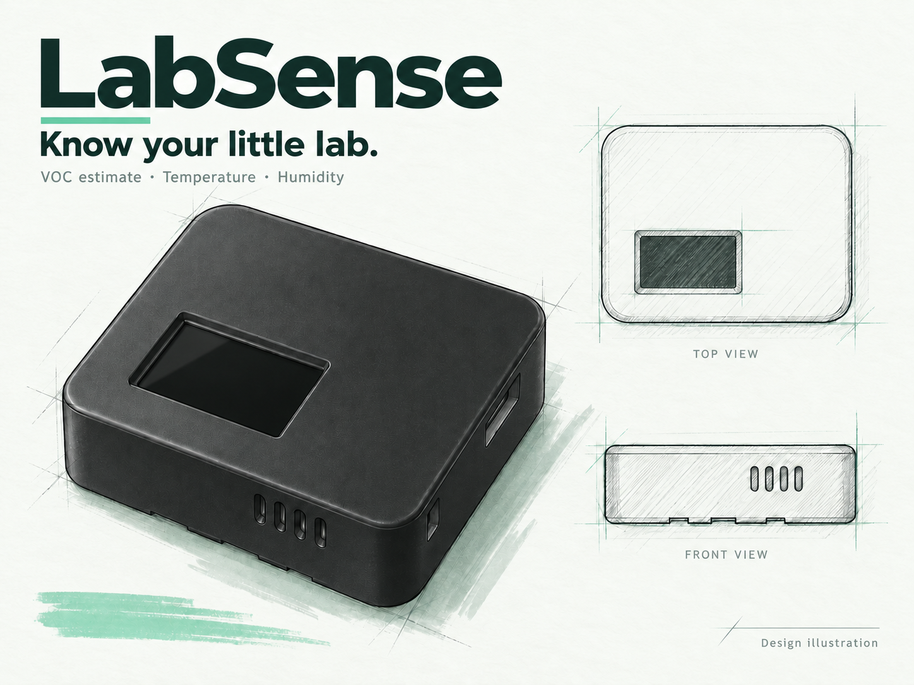
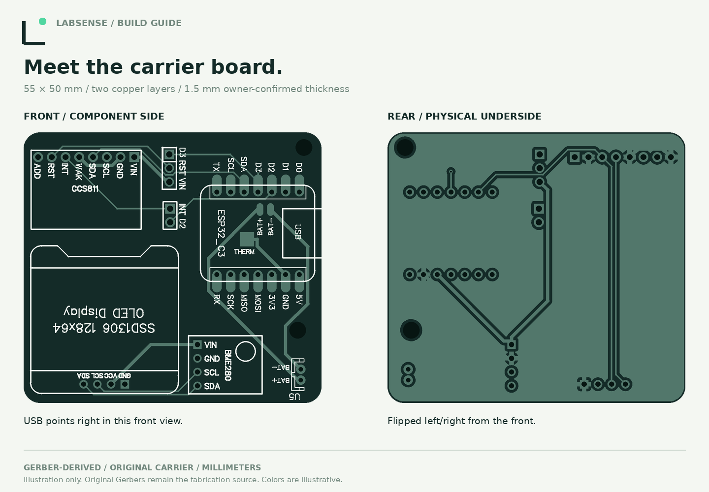
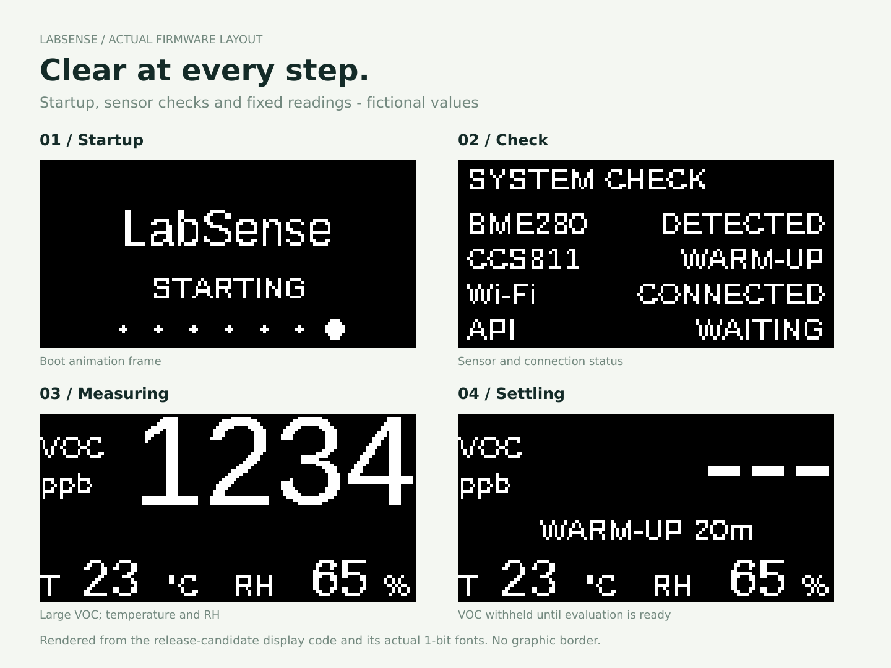

  <picture>
    <source media="(prefers-color-scheme: dark)" srcset="assets/brand/labsense-logo-light.svg">
    
  </picture>

<strong>Know your little lab.</strong>

LabSense Original is a small USB-powered room monitor for workshops, offices and hobby labs. A large VOC estimate, temperature and humidity stay visible on its OLED. ESPHome brings readings into Home Assistant over your local Wi-Fi, without a sensor-data cloud account.

I built it for a room shared with 3D printers, resin work and other projects. It is a useful way to notice changes and review trends, alongside proper extraction and ventilation. It cannot tell you that the air is safe.

**Source version: 1.3.0-rc6 (release candidate).** Complete-device accuracy and alternative-module fit are not certified. This repository covers the **original XIAO ESP32C3 + CCS811 + BME280 device only**. Its case revision v3 and software version 1.3.x are not LabSense v2. Second-generation hardware is developed separately.

## Build your own

| Start here | What it covers |
| --- | --- |
| **[Illustrated assembly manual](docs/assembly.md)** | PCB ordering, pin checks, soldering, first power and enclosure assembly |
| [Parts and estimated cost](docs/sourcing.md) · [BOM](hardware/bom/parts.csv) | Exact signal order, supplier candidates and substitution traps |
| [Bare PCB order](docs/pcb-ordering.md) · [Gerber ZIP](hardware/pcb/source/LabSense-Original-Gerbers.zip) | Upload to PCBWay or JLCPCB, review and order bare carriers |
| [Wiring alternative](docs/wiring.md) | The same electronics on breadboard, perfboard or your own carrier |
| [Enclosure and MakerWorld files](hardware/enclosure/README.md) | Model availability, print and assembly instructions; no 3D files on GitHub |
| [Build and flash firmware](docs/firmware.md) | Complete ESPHome source and USB installation |
| [Set up Wi-Fi and Home Assistant](docs/installation.md) | Save the individual key, choose Wi-Fi and pair locally |
| [Complete documentation](docs/index.md) | Operation, recovery, pinouts, sensor behavior and reference comparisons |

The carrier is **55 × 50 × 1.5 mm**, with socketed XIAO ESP32C3, CCS811, genuine BME280 and a four-pin 0.96-inch SSD1306. Match the module pin labels before ordering: some otherwise similar displays swap VCC and GND. Approximately **€32–37 in materials** is a planning estimate with an allocated PCB and existing USB accessories, before shipping; see the dated purchasing assumptions.

## A simple first connection

Flash the complete source over USB. Join the LabSense hotspot using the password on the display. Open `http://192.168.4.1`, **copy or save the individual Home Assistant key**, then choose your 2.4 GHz Wi-Fi. Return your phone to home Wi-Fi and add the discovered ESPHome device in Home Assistant. The Wi-Fi portal works on iPhone; supported clients can also use Improv BLE. [Full setup and recovery instructions](docs/installation.md).

The display has startup checks and one fixed VOC/temperature/RH view, with four selectable orientations. A new sensor needs **48 continuous hours** of valid gas sampling under the firmware's conditioning policy. Later restarts use **20 minutes**, plus one minute after a successful baseline restore. Temperature and humidity appear independently. [Sensor behavior](docs/engineering/measurement.md).

## Understand the readings

CCS811 gives a broad VOC estimate. It does not identify resin chemicals, measure printer particles or directly measure CO₂. A low reading cannot certify safe air. Configurable warning thresholds are technical indicators, not health or workplace exposure limits. Use appropriate ventilation and source controls, and compare the assembled temperature/humidity readings with a suitable reference before applying an offset.

## Files and licenses

Firmware source and the offline setup page are included so you can build and inspect the software. The original Gerber ZIP is the PCB manufacturing input. Enclosure CAD, meshes and print profiles are distributed **only on MakerWorld**; the model listing is awaiting publication.

Original software: **MIT**. PCB design: **CERN-OHL-P-2.0**. Documentation and original illustrations: **CC BY 4.0**. Enclosure models: **MakerWorld Standard Digital File License**. See [license scopes](LICENSE.md), [third-party notices](THIRD_PARTY_NOTICES.md) and [security](SECURITY.md). Product sketches are design illustrations; example interface values are fictional. Real prototype photographs are identified in the build guide.
