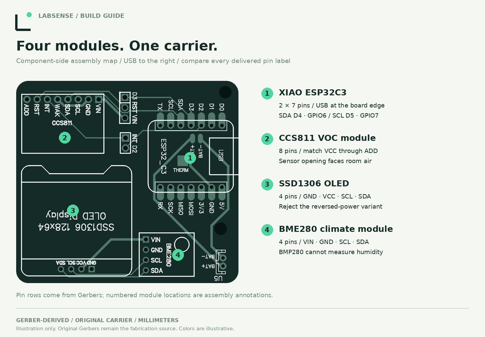
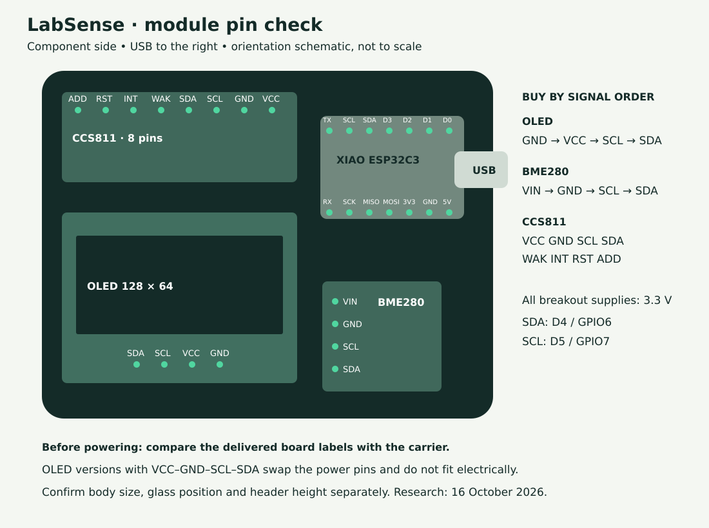
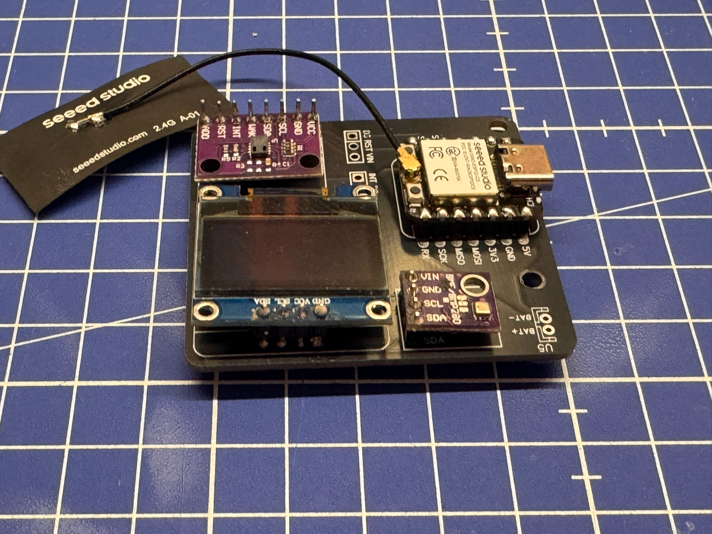
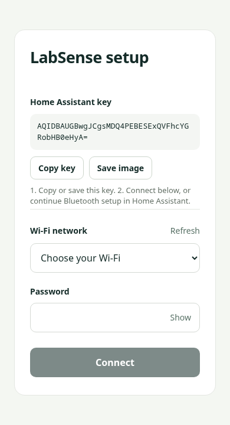

# Build LabSense: PCB to first reading

This guide follows the original **55 × 50 × 1.5 mm carrier**, socketed modules and USB-powered enclosure v3. Firmware is currently **1.3.0-rc6**, a release candidate with physical acceptance still in progress. No editable PCB schematic was supplied; pin connections are reconstructed from the original Gerbers and checked against the fitted prototype.

**Build route:** [order the carrier](pcb-ordering.md) → [buy matching modules](sourcing.md) → check pins and heights → solder → check power → [install and connect](installation.md) → allow sensor conditioning → [close the enclosure](enclosure.md).

## 1. Order the bare PCB

Download the [original Gerber ZIP](../hardware/pcb/source/LabSense-Original-Gerbers.zip), then upload it unchanged to [PCBWay Quick Order](https://www.pcbway.com/QuickOrderOnline.aspx). Select a **single-design, two-layer FR-4 bare board, 55 × 50 mm, 1.5 mm thick**. Choose your preferred solder-mask color; black matches the prototype. Confirm 1.5 mm with the fabricator if the standard form offers 1.6 mm. Review the layer assignment, outline, drills, thickness, fabrication questions and delivered price before paying.

PCBWay supplies the **carrier only** for this order. You buy and solder the controller, sensor boards and display separately. See [the detailed order settings and layer map](pcb-ordering.md); the [parts budget](sourcing.md#price-estimate-for-one-sensor) separates production allowances from shipping, VAT and the cost of an entire first batch.

These are Gerber-derived copper/silkscreen illustrations, not photographs or a simulation of solder-mask appearance. Front means the component side with USB pointing right. The rear is physically flipped left/right; it is not a through-board top view. [Full-resolution front](images/assembly/pcb-front.png) · [Full-resolution rear](images/assembly/pcb-rear.png).

## 2. Collect the parts and tools

| Quantity | Component | Required variant |
| --- | --- | --- |
| 1 | Seeed Studio XIAO ESP32C3 | 4 MB, two 7-pin rows; external antenna connected |
| 1 | CCS811 VOC breakout | Eight-pin CJMCU-811-style layout below |
| 1 | BME280 breakout | Four-pin VIN–GND–SCL–SDA; **not BMP280** |
| 1 | SSD1306 OLED | 0.96 inch, 128 × 64 I²C; **GND–VCC–SCL–SDA** |
| 1 | LabSense carrier | Original Gerbers, 1.5 mm thickness |
| 30 each | Male contacts and female socket contacts | 2.54 mm pitch: 2×7, 1×8 and 2×4 on each side of the connection |
| 1 each | USB-C data cable and regulated 5 V USB supply | Data cable required for initial flashing |
| 1 set | Printed v3 base, lid and wall plate | PETG; three M3 × 12 cylinder/button-head screws |

The [purchasing guide](sourcing.md) has researched supplier links, part numbers, prices and substitution checks; the [CSV BOM](../hardware/bom/parts.csv) is the shopping reference. Example replacement modules are pin-layout candidates, not physically approved drop-in parts. The XIAO antenna is normally in its retail kit; check package contents.

Tools: temperature-controlled soldering iron with a suitable small tip, electronics solder and compatible flux, iron stand, board holder, cutters, tweezers, magnifier, multimeter, calipers and the appropriate M3 screwdriver. Use normal soldering ventilation and eye protection. No reflow oven or bare sensor-chip soldering is required: the small electronics already sit on breakout modules.

## 3. Identify every module before soldering

All modules go on the **component side**. The carrier silkscreen names the signals; match those names to the delivered module, including a module that appears rotated relative to its shop photograph.

| Position in the front view | Module | Pin order at its carrier row |
| --- | --- | --- |
| Upper right, USB outward | XIAO ESP32C3 | Upper row left→right: TX, SCL, SDA, D3, D2, D1, D0. Lower row left→right: RX, SCK, MISO, MOSI, 3V3, GND, 5V. |
| Upper left | CCS811 | Left→right: **ADD, RST, INT, WAK, SDA, SCL, GND, VCC**. The carrier calls the supply VIN. |
| Lower left, OLED pins at the lower edge | OLED | Left→right: **SDA, SCL, VCC, GND**. Read from its GND end: GND→VCC→SCL→SDA. |
| Lower right, pins along its left edge | BME280 | Top→bottom: **VIN, GND, SCL, SDA** |

Every breakout supply on this carrier is **3.3 V**. A “3–5 V compatible” module does not change the carrier pin order. Do not plug in an OLED with VCC/GND swapped. Do not identify BME280 by a shared “BME/BMP280” PCB label or by color. Larger, six-pin or differently arranged modules need a wiring or PCB redesign, even if their chip name is right.

The bus uses **D4/GPIO6 for SDA** and **D5/GPIO7 for SCL**, at 100 kHz. CCS811 WAK and ADD are grounded on the carrier, selecting address 0x5A. RST and INT are exposed at auxiliary headers but unused by this firmware. No jumper between those auxiliary headers is required. Leave the battery connector and underside BAT/THERM landing pads unused for this USB-only socketed build. [Full controller and auxiliary pin reference](hardware.md#controller-pin-reference).

## 4. Dry-fit the stack and solder the headers

The removable build uses **female sockets on the carrier and male pins on the modules**. The sockets sit above the component side; their solder tails pass through the carrier. The modules' male pins point down into those sockets. Do not use loose electrical contact as an alignment jig while power is connected.

Before fixing heights permanently, check the module outlines, socket spacing and the actual assembled stack with the enclosure. All vertical values use the **carrier underside as zero**:

| Check | Existing prototype measurement / design requirement |
| --- | --- |
| Carrier thickness | 1.5 mm |
| Case floor to carrier underside | 4 mm pin clearance |
| Highest point / OLED face | 9.5 mm above carrier underside |
| USB-C socket bottom / top | 5.2 / 8.9 mm above carrier underside |
| USB-C protrusion past carrier edge | 0.3 mm |
| OLED glass | 26.7 × 19.6 mm; confirm its position over the opening |

A different socket height changes connector and glass positions. These dimensions describe the existing assembly, not a guarantee for a supplier's replacement OLED. Never force the lid against the glass to compensate for a taller stack.

1. Disconnect USB and remove all modules. Inspect the bare carrier for shipping damage and compare the footprint labels with the parts.
2. Cut the sockets to the required lengths. Use an unpowered mating pin strip or a suitable jig to keep each row straight, parallel and seated; protect plastic and glass from the iron. The XIAO rows must match the module's 15.24 mm row spacing.
3. Tack one end pin of each socket, check seating and alignment, then tack the other end. Correct alignment before completing the remaining joints. Solder the carrier sockets from the underside.
4. Solder the male header rows to each module with the intended mating ends downward. Check alignment after the first joint. Keep the iron away from the OLED glass, flex connection, sensor openings and antenna connector. Use the soldering face appropriate to that breakout's pads; do not bridge opposite castellations or nearby parts.
5. Heat the pad and pin together, feed solder into the joint, then let it cool without movement. Look for a wetted connection to both surfaces, not a ball sitting on a cold pad. Lead-free solder can be matte; shine alone does not establish a good joint. [Soldering technique](https://learn.adafruit.com/adafruit-guide-excellent-soldering/making-a-good-solder-joint) · [fault examples](https://learn.adafruit.com/adafruit-guide-excellent-soldering/common-problems).
6. Inspect both sides under magnification. Repair bridges, loose pins and incomplete joints. Remove loose wire/solder debris. Keep flux and cleaner out of the sensor ports; do not immerse assembled sensor modules or spray their sensing openings. Follow the flux/module handling instructions and allow any permitted cleaning to dry completely.
7. Check underside protrusions against the available 4 mm. Trim only protruding solder tails where needed; do not shorten mating pins so much that they no longer engage their sockets.

## 5. Check electrical assembly before first power

With USB disconnected, use continuity mode to confirm the intended connections: XIAO GND to each module GND; 3V3 to CCS811 VCC/VIN, BME280 VIN and OLED VCC; D4 to each SDA; D5 to each SCL. Check for unintended bridges between neighboring pins and between 3V3 and GND. Do not use resistance or continuity mode on a powered board. Component capacitance can cause a brief transient indication; investigate a persistent near-zero rail resistance rather than powering through it.

Fit the XIAO and its antenna first. With the other modules removed, USB-power the controller/carrier and check that the intended breakout supply pads measure approximately **3.3 V relative to GND**. Avoid bridging pads with the probes. Disconnect USB before inserting or removing any module.

Insert the checked OLED, BME280 and CCS811 in their correct positions, with all pins aligned and none offset by one hole. Attach the external antenna gently, pressing the mating connector straight into place. Route its lead without pulling the connector. Keep foil and exposed solder tails electrically separated.

## 6. Install firmware and connect to Home Assistant

Follow [initial USB installation](installation.md#build-and-initial-usb-installation) for a new controller. Use the generic configuration for a fresh device; follow the [update precautions](firmware.md#updates-and-existing-devices) before upgrading already-paired legacy firmware. Firmware images and device keys are not embedded in this documentation.

1. Apply USB power. LabSense shows its startup animation and BME280/CCS811 recognition plus Wi-Fi/API status. Expected identities are BME280 **0x60** and CCS811 **0x81**; these are recognition checks, not proof of calibration or authenticity.
2. During first setup, join the displayed **LabSense + suffix** Wi-Fi using the displayed eight-digit password. Choose to remain connected without internet, then open `http://192.168.4.1` if the phone does not open the portal itself.
3. Press **Copy key** or **Save image** before connecting. This individual Home Assistant encryption key is different from both Wi-Fi passwords. Keep it for later pairing and encrypted updates; never publish it in screenshots or issues.
4. Choose a **2.4 GHz** home network, enter its password and select **Connect**. Refresh searches again; Other network allows a hidden/manual SSID. Optional **Display settings** chooses USB left/bottom/right/top and saves immediately.
5. Reconnect the phone to home Wi-Fi. In Home Assistant, open **Settings → Devices & services**, add the discovered ESPHome device and paste the saved key. If discovery is unavailable, manually add its router-assigned address on port **6053**.
6. Check that readings update and that **VOC evaluation ready** eventually becomes true. Connection to the network does not finish sensor warm-up. Notifications require a separate Home Assistant automation; this project does not install or edit one.

For BLE, copy/save the key in the portal first, then switch the phone back to home Wi-Fi and continue Home Assistant's Improv flow. Standard browser Improv does not work on iPhone; the Wi-Fi portal is its direct setup route. See [platform support and recovery](installation.md), including the eight-second BOOT hold **while already running**, followed by release. Recovery clears saved Wi-Fi while retaining the pairing key; a factory erase does not.

## 7. Let the sensors settle

| Situation | LabSense behavior |
| --- | --- |
| New device, generic image | **48 hours of continuous initial conditioning** from valid gas sampling before VOC evaluation is ready |
| Initial conditioning interrupted before completion | No partial-hours progress is saved; the next start begins the initial period again |
| Later restart, after conditioned state has been saved | **20 minutes** of VOC warm-up |
| Saved baseline restored | Restoration is attempted after the restart warm-up; **60 seconds** of additional settling after a successful restore |
| BME280 temperature/RH | Reports independently of the long VOC conditioning; allow the assembled device and room to reach thermal equilibrium |
| Sensor fault, missing compensation or stale gas data | VOC assessment unavailable; inspect the fault before interpreting numbers |

The 48-hour period is **LabSense's conservative firmware policy**, not a universal manufacturer requirement or a calibration certificate. CCS811 revisions have differing manufacturer guidance; the [ams datasheet-change notice](https://ams.com/documents/20143/307151/CN18-2018_Change%20notification%20for%20CCS811%20datasheet%20updates.pdf) specifically revises estimated-output timing. Do not mark a fresh sensor as already conditioned just to bypass the waiting period. Let completed conditioning/settings save before removing power. Factory erase also clears the software's remembered conditioning state.

During warm-up the OLED shows dashes and **WARM-UP**, while temperature/RH remain visible. The API may expose raw VOC estimates before readiness; use **VOC evaluation ready** and the diagnostic status when deciding whether to interpret them. Warning entities are unavailable while assessment is unavailable, rather than reporting a healthy false/zero. The default high indication is 2,000 ppb sustained for 30 seconds in Home Assistant; the OLED flags a valid, ready high estimate immediately. These are configurable technical indications, not health or workplace exposure limits.

CCS811 estimates broad VOC behavior; it does not identify resin chemicals, directly measure CO₂ or measure printer particles. BME280 supplies temperature/humidity compensation; neither an I²C response nor a plausible number proves measurement accuracy. The [measurement guide](engineering/measurement.md) and [reference-comparison procedure](engineering/validation-plan.md) explain the remaining validation. Use ordinary room observations, not deliberate hazardous emissions, for commissioning.

## 8. Finish the enclosure and record the result

Check the open assembly before closing the [v3 enclosure](enclosure.md). Keep sensor ports and vents clear, do not pinch the antenna cable, confirm USB access and avoid glass pressure. Close with three M3 × 12 cylinder/button-head screws, gently by hand. Fit the wall plate only after the complete assembly works. The documented under-PCB antenna position still needs reception checks in the real installation.

Record the actual module variants, socket height, firmware version, startup recognition, saved-key pairing, warm-up completion, display orientation and fit. Compare closed-case temperature/RH with a suitable reference before applying an offset; no verified product accuracy is currently claimed. Verify the fit of your actual print and module stack before final installation.

If something does not work:

| Symptom | First check |
| --- | --- |
| Blank OLED | Correct GND/VCC order, 3.3 V rail, complete header insertion and supported address 0x3C/0x3D |
| BME fault / no humidity | Genuine BME280 identity 0x60, four-pin order and 0x76/0x77 address; a BMP280 is unsuitable |
| VOC fault | Eight-pin order, WAK/ADD ground connections, solder joints and 0x5A device response |
| VOC warm-up persists | New-device 48-hour policy, uninterrupted valid sampling and no recurring sensor faults |
| Empty network list | Wait for scan completion, tap Refresh, check 2.4 GHz coverage; use the documented recovery flow if necessary |
| Home Assistant asks for a key | Use the copied individual encryption key, not the hotspot password; retrieve it through physical BOOT recovery if lost |
| Temperature reads high after closing | Check ventilation, heat sources and settling; follow the reference-comparison procedure |

[Operation and troubleshooting](operation.md) · [Full hardware reference](hardware.md) · [Software and measurement status](firmware.md#software-status)
