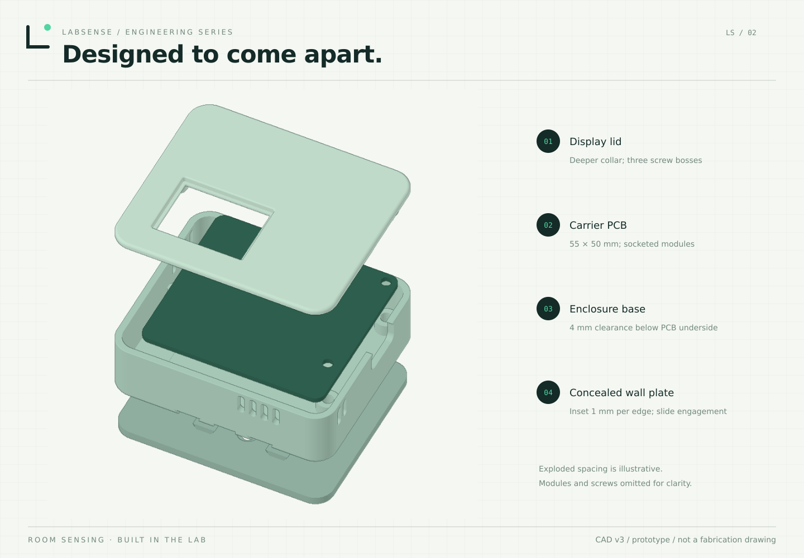

# LabSense Original enclosure (case revision v3)

The current enclosure uses a screw-fastened lid and a concealed slide-on wall plate. The antenna foil sits in a shallow recess below the PCB. The enclosure is intended for indoor use and is ventilated; it has no ingress-protection rating.

Complete the [PCB soldering and first-power checks](assembly.md) before closing the case. The selected sockets and module heights determine whether the USB connector and display fit their openings.

| Feature | Nominal value |
| --- | --- |
| Case | 66.5 × 57 × 19.8 mm |
| Mounted depth | 22.5 mm, excluding adhesive and wall unevenness |
| Wall plate | 64.5 × 55 × 2.4 mm |
| Wall-plate perimeter inset | 1 mm per edge |
| PCB standoff | 4 mm to carrier underside |
| Slide clearance | 0.25 mm |
| Vent slots | 2.2 × 6.5 mm |
| Display collar depth below inner lid | 1.5 mm |
| Glass-to-upper-frame gap | 0.2 mm |
| Straight collar-side gap | 0.3 mm |
| Glass overlap | 0.5 mm per side |

The third fixing extends the left side of the case by 4.5 mm. The PCB, USB opening and outer display opening retain their earlier positions. The old small floor tabs and fragile hooks are removed.

## Print files

Download the enclosure and its print profile from [the LabSense MakerWorld model](../hardware/enclosure/README.md). GitHub hosts the instructions and measurements; the 3D files are distributed only on MakerWorld under its Standard Digital File License.

The dimensions above describe the original case revision v3. They do not describe a second-generation LabSense device.

## Print and assemble

Printer: **Bambu Lab H2D**, **0.4 mm nozzle**, **black PETG**. Use the attached MakerWorld 3MF and inspect its material and settings in the slicer. The PETG starting point is 0.16 mm quality, Arachne walls and automatic supports; confirm the actual supplied profile before printing. Keep supports out of sliding surfaces.

1. Print Base with its rear face on the bed, Lid with the smooth outer face on the bed, and WallPlate with its flat wall face on the bed. Check the supplied 3MF orientation and millimeter scale.
2. Check underside pin clearance and place the foil antenna in its recess without crushing the cable or touching exposed pins.
3. Seat the PCB. Inspect the glass collar before tightening: no printed edge should press onto the display.
4. Close with **3 × M3 × 12 mm cylinder-head or button-head screws**, length measured under the head. **No countersunk screws.** Rear head pockets are Ø6.4 × 3.2 mm; lid pilot holes are Ø2.5 mm. Form the thread carefully and tighten lightly by hand.
5. Glue or screw the wall plate to a suitable wall. Slide the case down onto it; leave space above for removal. The slide has no anti-lift lock.

CAD checks found closed solids and meshes, clear nominal component envelopes and a clear insertion path. Those checks do not replace a printed v3 fit check, real screw-head measurements or a temperature comparison in the closed enclosure.

## Assembly illustration

Exploded spacing is illustrative; electronic modules and screws are omitted for clarity. Use the supplied MakerWorld model and measurements above for fit.
