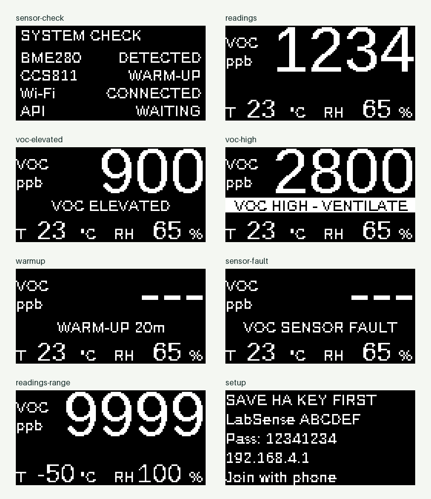
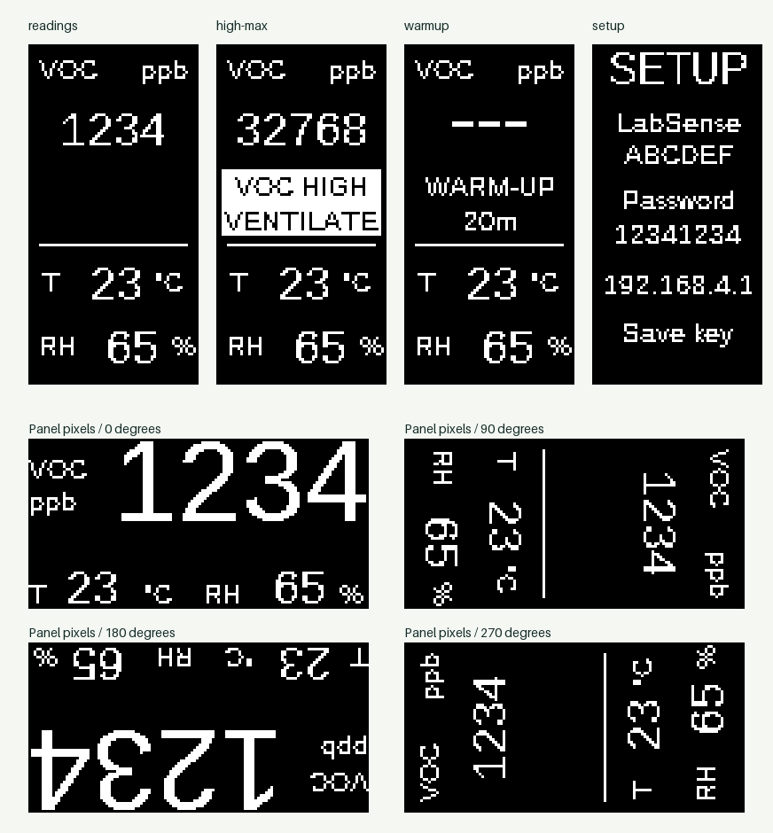

# OLED interface specification

The display is SSD1306, 128 × 64 monochrome pixels. `firmware/release/oled_ui.h` owns the device-independent layout and state policy; `oled_canvas.h` adapts it to ESPHome. The current release interface is English.

## Startup and runtime

| Phase | Duration / behavior |
| --- | --- |
| Start animation | 2.4 s after UI startup; LabSense and moving dots |
| System check | Until 7 s; BME280/CCS811 recognition plus Wi-Fi/API connection state |
| Runtime | One fixed borderless view: large VOC estimate, temperature and RH below |
| Warm-up or fault | Explicit status text and unavailable VOC dashes; climate row retained |
| High VOC | Inverted ventilation warning between VOC and the climate row |

The fixed view uses the full panel without a border, with **ppb** as the CCS811 estimate's native unit (1 ppm = 1,000 ppb). Temperature and RH are rounded to whole units on this small screen; sensor/API precision is unchanged. A compact font accommodates five-digit VOC values. There is no normal-view smiley or rotating progress bar.

The boot check reads BME280 ID 0x60 and CCS811 ID 0x81; recognition is not calibration or an accuracy test. API indicates any native API connection, not verified Home Assistant client identity. Local measurements continue while connectivity is unavailable.

## Orientation and persistence

| USB position, viewed from the front | Clockwise rotation | Logical layout |
| --- | --- | --- |
| Left, original view | 0° | 128 × 64 landscape |
| Bottom | 90° | 64 × 128 portrait |
| Right | 180° | 128 × 64 landscape |
| Top | 270° | 64 × 128 portrait |

The setup page's optional **Display settings** and the native API's **Display orientation** control share the same persisted setting. `display_settings.h` validates only these four values, saves to a dedicated preference and synchronizes before reporting success. HTTP queues changes onto the main loop; the page confirms the resulting value before displaying Saved. Orientation changes do not erase networking or pairing preferences. Startup, setup, button-release instructions and runtime all have portrait layouts; rotation is not implemented by clipping landscape content.

The existing commissioning rules still govern portal availability. During normal operation use the paired native API setting; this change does not add a permanently exposed web settings server.

## State priority

1. A held recovery button shows its release instruction.
2. A high VOC condition shows readings and the warning even if the ordinary display is off.
3. Startup and then authorized setup instructions take precedence over the normal view.
4. Otherwise the display-enabled setting applies; fault/warm-up text replaces unavailable VOC values within the fixed view.

Status reacts to a current valid, ready threshold crossing and respects latched warnings/hysteresis. Home Assistant warning timers remain unchanged, so the display may warn before the sustained alarm entity. No status proves that all air pollutants are safe.

The screen clock uses monotonic 64-bit uptime. Boot animation updates at 4 Hz; after eight seconds it reduces to 1 Hz to limit I²C traffic. Missing climate values print dashes, never zero.

## Display examples

These illustrations show the firmware layout with fictional values; they are not calibration evidence. Landscape uses 128 × 64 pixels and portrait uses 64 × 128 pixels.

The underlying ESPHome interfaces are documented in [display](https://esphome.io/components/display/) and [template select](https://esphome.io/components/select/template/).
