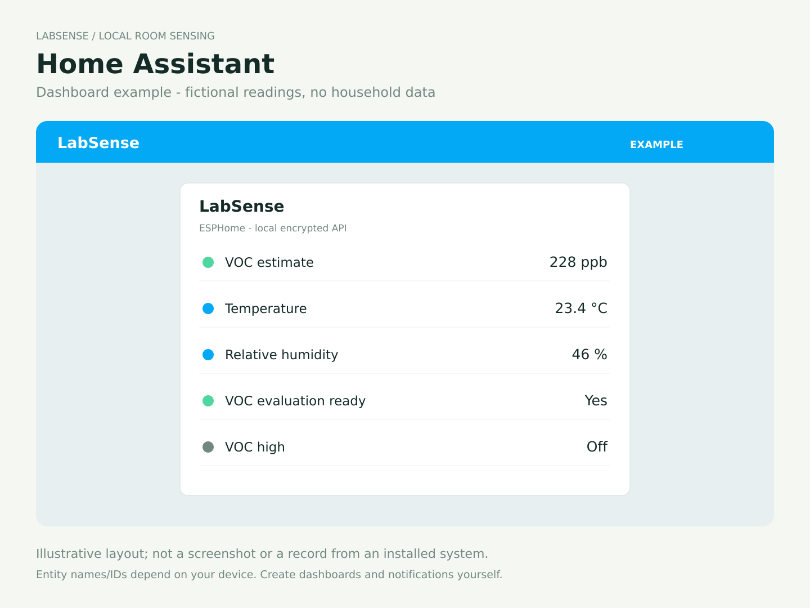

# Install and commission LabSense

Applies to **1.3.0-rc6**, XIAO ESP32C3, 4 MB. Hardware acceptance is pending; see the [software status](firmware.md#software-status). Use the release configuration for new devices. Do not flash it over an already paired legacy device without a migration plan: its compiled-in key and network identity may differ.

Building from parts? Start with the [illustrated PCB, pinout and soldering guide](assembly.md). It includes electrical checks before USB power and the [sensor conditioning schedule](assembly.md#7-let-the-sensors-settle).

## Build and initial USB installation

From the repository root, create the Python environment described in [firmware build instructions](firmware.md), then run:

```sh
.local/venv/bin/python tools/build_release.py
.local/venv/bin/esphome upload firmware/release/labsense.yaml --device YOUR_SERIAL_PORT
```

Use a USB data cable. Choose the connected XIAO's serial port. A factory image is for initial serial installation; an OTA image is for application updates. Do not write an OTA application image at flash address zero. If normal serial detection fails, use the XIAO's documented bootloader procedure and release BOOT after entering download mode. Never erase an existing paired device as a routine update.

The generic release configuration contains no home-network credentials or API key. Each device creates and saves its own pairing key and setup password. Build output stays under ignored firmware caches. No public binary has been approved yet.


## Bluetooth setup (Improv BLE)

During initial commissioning or explicit BOOT recovery, LabSense advertises the Improv BLE service for up to ten minutes after boot. Its Bluetooth name is LabSense with a unique suffix. A routine router outage does not authorize BLE setup. Connection to Wi-Fi closes the setup window; BOOT recovery reopens it without rotating the Home Assistant key.

- **Home Assistant:** with a working Bluetooth adapter or compatible active proxy within range, look under Settings → Devices & services for the discovered Improv device and follow the Wi-Fi setup steps. LabSense does not change Home Assistant settings itself.
- **Android / supported computers:** open [Improv Wi-Fi](https://www.improv-wifi.com/) in a supported Chrome/Edge browser, select LabSense and supply the 2.4 GHz Wi-Fi name and password. This is a website device chooser, not the operating system Bluetooth pairing screen.
- **iPhone/iPad:** use Home Assistant's Improv flow when its Bluetooth coverage is available, or use the Wi-Fi portal below. Standard browser-based Improv does not support iOS.

**Save the key before either connection path:** open the LabSense hotspot portal first and press **Copy key** or **Save image**. The page confirms this to the device without sending the key outside the sensor. You can then connect through the portal. For BLE setup, reconnect the phone to its normal home Wi-Fi first (without pressing Connect in the portal), then return to Home Assistant's Improv flow. The sensor stays in its setup window while the phone switches networks. BLE stays in “awaiting authorization” until the key is saved in this setup session. Home Assistant's standard Improv dialog cannot display the key itself; it will wait for this authorization. If it asks to authorize the device, copy/save the key in the portal; do not hold BOOT again, because that starts a new setup session. This avoids reaching ESPHome pairing with an unseen key. The API key is not changed by recovery or ordinary firmware updates and is never placed in a redirect URL.

If a portal cannot retrieve the key, it shows a BOOT recovery instruction and leaves Connect disabled. It never silently hides that step. iOS clipboard copying uses an explicit selectable text fallback; Save image remains available.

Provision in a trusted location. Standard Improv BLE is a proximity setup protocol, not a password-authenticated replacement for encrypted OTA. Its limited setup window and physical recovery requirement restrict when credentials can be submitted.

## Wi-Fi scanning

The portal requests a fresh scan when opened or refreshed, waits for a completed scan result and retries empty lists. It polls pending status rather than assuming that scanning has finished after a fixed delay. Scan failure is shown separately from a completed empty result. Firmware keeps full scan results and limits scans to one per 15 seconds, deferring them during connection attempts. BOOT recovery deletes the saved Wi-Fi preference rather than storing an empty SSID wildcard. Only 2.4 GHz networks are supported; hidden networks can be entered with **Other network**. Manual SSID entry also remains available while diagnosing reception problems.

## First connection

1. Power the sensor. Read the **LabSense + six-character suffix** Wi-Fi name and eight-digit password on its display.
2. Join that network on your phone. Stay connected if the phone reports “no internet.”
3. Open the setup prompt, or enter `http://192.168.4.1` while joined to the sensor.
4. **Copy key** or **Save image**. Keep the key for Home Assistant and future encrypted updates.
5. Choose your 2.4 GHz home Wi-Fi, enter its password, and select **Connect**. “Other network” allows a manually entered SSID. Open networks have no password field requirement; supported passphrases are 8–63 bytes.
6. Reconnect the phone to home Wi-Fi. In Home Assistant, open **Settings → Devices & services**, select the discovered ESPHome device and enter the saved key. If discovery is blocked by your network, add ESPHome manually with the sensor's router address and port 6053.

The firmware does not configure Home Assistant notifications or automation. Home Assistant and the sensor must have network connectivity to each other. A setup page becoming unreachable is not proof that the sensor joined Wi-Fi; confirm the device in your router or Home Assistant.



## Recover Wi-Fi setup or a lost pairing card

With the sensor already running, hold its **BOOT button for eight seconds**, then release it when the display asks. It restarts into setup recovery, clears the saved Wi-Fi credentials and retains the API key. Join the displayed setup network, copy/save the existing key, and enter the new network details. Do not hold BOOT while applying power unless you intend to enter the USB bootloader.

Recovery requires physical access to the board button; the current enclosure may need to be opened. The normal reset button only restarts the sensor. A factory erase removes all settings and creates a new pairing identity on the next boot.

## Encrypted updates

After an approved release is available, use its OTA image and your saved key:

```sh
.local/venv/bin/python tools/update_device.py --host YOUR_SENSOR.local --image PATH_TO_FIRMWARE.ota.bin
```

The tool prompts privately for the key. It refuses plaintext fallback. Do not put the key in a command-line argument or issue report. Preserve your pairing card across updates. If the application cannot boot, USB is the recovery route; this candidate disables ESPHome's automatic safe-mode boot path to ensure setup credentials are initialized before the radio starts.

The optional **Display settings** section lets you select the USB-port position before connecting. It saves immediately. The same saved **Display orientation** setting is available through the native API after pairing; see [operation](operation.md#display-orientation). All current release interface text is English.
