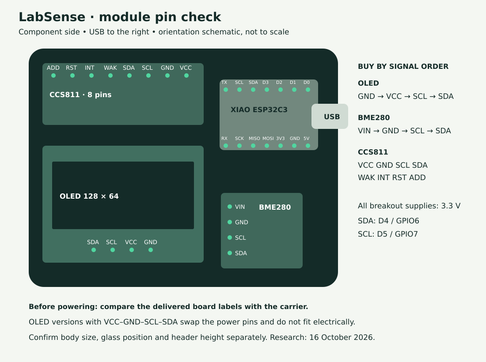

# Parts and purchasing guide

Research checked **16 October 2026**; prices are a snapshot, not a checkout quote. This guide targets the supplied 55 × 50 mm carrier and enclosure v3. Order one sample of a replacement module before buying a batch.

The original shops are unknown. The candidates below match published pin layouts or supplier photographs; they have **not been fitted to the prototype**. A matching chip name alone does not establish compatibility. Board color is not an identification method.

Use the [illustrated build guide](assembly.md) to identify the board positions, solder the socket/header stack and perform first-power checks. The [hardware reference](hardware.md#controller-pin-reference) includes all XIAO pins and the unused auxiliary connections.

## Shopping list

| Qty | Part to order | Example source / exact listing | Selection requirement |
| --- | --- | --- | --- |
| 1 | Seeed Studio XIAO ESP32C3, 4 MB, without presoldered headers | [BerryBase SE-113991054](https://www.berrybase.de/seeed-xiao-esp32c3-winziges-mcu-board-mit-wlan-und-ble), manufacturer SKU 113991054 | ESP32C3 XIAO; two 7-pin rows, 2.54 mm pitch and 15.24 mm row spacing. Other XIAO processors and C3 Super Mini are not this build. |
| 1 | CCS811, purple CJMCU-811 style, eight pins | [BerryBase CJ-CCS811](https://www.berrybase.de/ccs811-luftqualitaets-sensor-mit-breakout-board) | Supplier photo matches VCC–GND–SCL–SDA–WAK–INT–RST–ADD. Approx. 20 × 15 mm; check the delivered board. |
| 1 | BME280, small four-pin I²C breakout | [HESTORE BME280-M, 100.390.68](https://www.hestore.eu/en/prod_10039068.html) | [Module drawing](https://www.hestore.eu/en/prod_getfile.php?id=16092): VIN–GND–SCL–SDA, 2.54 mm pitch, approx. 12.8 × 10.5 mm. Check lead time. |
| 1 | White SSD1306 OLED, 0.96 inch, 128 × 64, four-pin I²C | [HESTORE D096-12864-I2C-GV-WH, 100.483.04](https://www.hestore.eu/en/prod_10048304.html) | Explicit **GND–VCC–SCL–SDA**. Listed PCB 27.3 × 27.8 × 3.7 mm; glass position and enclosure fit still need checking. |
| 1 | LabSense bare carrier PCB | [PCBWay ordering guide](pcb-ordering.md) | Supplied Gerber ZIP, 2 layers, FR-4, **1.5 mm design thickness**. |
| As below | Straight 2.54 mm male headers and matching female sockets | Electronics distributor of choice | Two 1×7 sets, one 1×8, two 1×4. Preserve the original assembled height. |
| 1 set | Printed enclosure base, lid and wall plate | [MakerWorld print files](../hardware/enclosure/README.md) | Black PETG, 0.4 mm nozzle; see [assembly guide](enclosure.md). |
| 3 | M3 × 12 mm cylinder/button-head screws | Fastener supplier of choice | No countersunk heads; check head ≤ Ø6 × 3 mm against Ø6.4 × 3.2 mm pockets. |
| 1 each | USB-C cable and regulated 5 V USB supply | Existing suitable USB accessories or electronics supplier | Cable must clear the case opening. Use a data cable for initial USB flashing. |
| Optional | Two wall screws with suitable anchors, or suitable mounting adhesive | Choose for the actual wall | Wall plate slides onto the case; no magnets required. |

The XIAO retail kit normally includes its external antenna: [Seeed getting-started guide](https://wiki.seeedstudio.com/XIAO_ESP32C3_Getting_Started/). Confirm package contents; the enclosure was designed around the original **40 × 20 mm foil and approximately 60 mm lead**. A different supplied antenna may require a placement change. Do not automatically buy a second antenna.

The original assembly uses removable module connections. A complete male/female set needs **30 contacts on each side**: 14 XIAO + 8 CCS811 + 4 OLED + 4 BME280. Buy sufficient strip lengths, allowing for cutting waste. Included loose male headers can reduce purchases. Socket heights are not interchangeable: generic tall sockets or directly soldering the XIAO can move both the USB socket and display relative to their openings.

## Compare the pins before ordering

The diagram shows the **component side, USB to the right**, matching the assembled prototype. Pin sequences in listings are often shown with a module rotated. Match signal labels and location, not merely left/right in an unrelated photograph.

| Module | Required sequence, starting at named end | Carrier behavior |
| --- | --- | --- |
| OLED | **GND → VCC → SCL → SDA**, starting at GND | Power is 3.3 V; address 0x3C / 0x3D supported. |
| BME280 | **VIN → GND → SCL → SDA**, starting at VIN | Power is 3.3 V; firmware checks 0x76 / 0x77 and BME280 chip identity. |
| CCS811 | **VCC → GND → SCL → SDA → WAK → INT → RST → ADD**, starting at VCC | Power is 3.3 V; WAK and ADD grounded, address 0x5A. INT/RST go to auxiliary headers. |

A concrete OLED trap: HESTORE sells both **GV-WH (100.483.04)** above and [**VG-WH (100.479.53)**](https://www.hestore.eu/en/prod_10047953.html). The latter swaps VCC/GND and is **not compatible with direct insertion**. Do not power a mismatched module. Different suppliers may use unrelated suffixes; always read their pin labels.

A second OLED candidate is [Makeroo MKR-0.96-OLED-015](https://makeroo.de/products/096-zoll-oled-display-modul-ssd1306-i2c-spi-128x64-fuer-arduino-weiss), listed at €2.99 with GND–VCC–SCL–SDA in its description. Its page includes a reported photo/pin-order discrepancy: obtain confirmation of the shipped batch. It is not a mechanically validated replacement.

For BME280, [ProtoSupplies' four-pin module](https://protosupplies.com/product/bme280-i2c-pressure-humidity-temperature-sensor-module/) is another published VIN–GND–SCL–SDA option; check destination shipping. Reject a **BMP280**: it cannot measure humidity, even when a shared PCB says “BME/BMP280.” The installed firmware checks BME280 identity (chip ID 0x60) and treats absent humidity compensation as invalid. Six-pin, Grove and larger branded boards need a different mounting/wiring arrangement.

For the OLED, reject 0.91-inch 128×32, 1.3-inch SH1106 and six/seven-pin SPI versions for this build. An SSD1315 listing is not a confirmed SSD1306 replacement. For CCS811, other breakout layouts are not substitutes just because the sensor chip matches.

All carrier breakouts run from **3V3**, with SDA on XIAO D4/GPIO6 and SCL on D5/GPIO7 at 100 kHz. Check any substitute's pull-ups and voltage compatibility. [Carrier connections and measurement datums](hardware.md) take precedence over generic shop wiring examples.

## Mechanical acceptance before soldering

1. Lay each unpowered module over its footprint. Verify labels, 2.54 mm pin pitch, body outline and clearance to adjacent parts. Inspect the reverse side for solder joints that could touch the carrier.
2. Dry-fit the selected headers. The PCB is **1.5 mm** thick; enclosure standoffs provide **4 mm under its underside** for protruding pins.
3. Check OLED glass **26.7 × 19.6 mm**, its position over the opening, and face **9.5 mm from carrier underside**. These measurements describe the existing assembly, not dimensions guaranteed for the replacement OLED. Check its PCB outline and fixing-hole locations too.
4. Check USB-C bottom **5.2 mm**, top **8.9 mm**, and protrusion **0.3 mm beyond the carrier edge**, using that same underside datum. Dry-fit the lid without forcing the glass or connector.
5. Confirm BME280 identity and all I²C devices during initial firmware commissioning. An I²C address alone does not prove a genuine sensor or correct measurement performance.

Do not seal sensor openings with glue or foam. Keep ventilation paths clear and put the antenna in its intended space below the PCB without pinching the lead. Enclosure v3 and any newly sourced modules still require a physical fit check.

## Price estimate for one sensor

| Item | Observed price / planning allowance | Basis |
| --- | --- | --- |
| XIAO from BerryBase | €7.90 | Listed including VAT, excluding delivery |
| CCS811 from BerryBase | €11.80 | Listed including VAT, excluding delivery |
| BME280-M from HESTORE | €5.008 net → **€5.96** | Live page; illustrative 19% German VAT |
| GV-WH OLED from HESTORE | €2.576 net → **€3.07** | Live page; illustrative 19% German VAT |
| **Electronics subtotal** | **€28.73** | One of each; rounded per line |
| Headers / sockets | €1–2 | Planning allowance; strip lengths and height affect price |
| Three enclosure screws | €0.30–1 | Planning allowance; pack minimum may cost more |
| Printed PETG enclosure | €1–2 | Material allowance only; no printer/labor charge |
| Carrier, allocated from batch | €1–3 | Planning allowance, **not a PCBWay quote** |
| **Estimated material total** | **about €32–37** | Existing USB cable/supply; shipping excluded |

Optional new USB cable: allow €3–6; USB supply: €5–10. These are budgeting assumptions, not researched product quotes. Wall fixings/adhesive, tools, solder, electricity, failed prints and labor are excluded.

For a first build you pay for whole header/screw packs and the **whole PCB order**, not just one allocated PCB. Allowing €5–15 for bare-PCB production gives approximately **€36–49 before all delivery charges**, using the electronics subtotal and small-parts allowances above. The 1.5 mm thickness may change the fabrication quote. Obtain the actual PCBWay quote and delivery/tax totals before purchasing.

Prices were checked on live supplier pages; search-engine cached prices differed for HESTORE, so the live amounts are used. The 19% VAT conversions are estimates; the shop's destination-specific checkout determines the payable tax. Separate BerryBase, HESTORE and PCBWay parcels can make delivery a substantial part of the first-unit cost. No fixed landed price or delivery time is promised.

[Download the purchasing BOM](../hardware/bom/parts.csv) · [Price calculation data](../hardware/bom/pricing.json) · [Order the carrier PCB](pcb-ordering.md)
