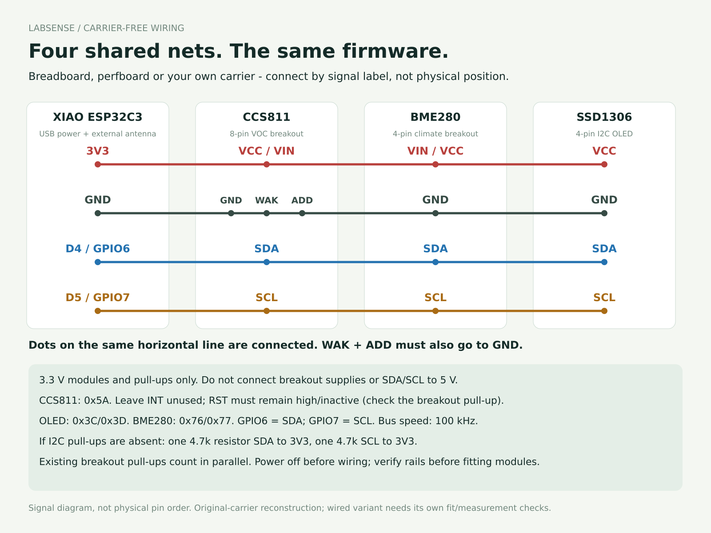

# Build without the LabSense carrier PCB

A breadboard, soldered perfboard or your own carrier can connect the **same XIAO ESP32C3, CCS811, BME280 and SSD1306 modules**. The release ESPHome configuration works unchanged when the signal mapping below is preserved. This is a signal-level alternative to the reconstructed carrier connections, not a tested new PCB design.

The drawing groups pins by electrical net; **it does not show their physical order**. Connect by the labels on the actual module. All listed terminals in one row share one electrical connection. Use breakout modules rated for operation and I²C logic at 3.3 V, not bare sensor chips.

| From XIAO ESP32C3 | CCS811 breakout | BME280 four-pin breakout | SSD1306 I²C OLED |
| --- | --- | --- | --- |
| **3V3** | VCC / VIN | VIN / VCC | VCC |
| **GND** | GND, **WAK / nWAKE**, **ADD / ADDR** | GND | GND |
| **D4 / GPIO6** | SDA | SDA | SDA |
| **D5 / GPIO7** | SCL | SCL | SCL |

CCS811 WAK held low enables communication; ADD held low selects **0x5A**, which this firmware expects. Ground both explicitly when exposed; do not assume a module's jumpers select the same states. Leave CCS811 INT/nINT disconnected. RST/nRESET is not controlled by the firmware and is left externally unconnected on the original carrier; verify that the selected breakout holds reset inactive/high. If its board lacks a suitable reset pull-up, provide one per the module's schematic (a 10 kΩ pull-up to 3V3 is a common implementation). Do not ground RST, and do not mistake WAK for RST.

## Power and pull-ups

- Power the XIAO through USB. Feed the three breakout modules from its **3V3**, not its 5V/VBUS pin. Keep battery pads unused. Connect the external XIAO antenna before operating the radio.
- Use one common ground. If a breadboard rail is split in the middle, bridge and continuity-check the sections you use. Some breadboards do not connect both sides of a power rail.
- Keep SDA/SCL jumpers short (a compact bench assembly, roughly 10–20 cm rather than a room-scale cable) and retain the firmware's **100 kHz** bus. This suggested length is a practical starting point, not a tested guaranteed limit.
- I²C needs pull-ups to **3V3**. Breakouts often include them. Inspect their schematics or measure the assembled unpowered network; do not blindly add a pair to every module. If absent, start with **one 4.7 kΩ resistor from SDA to 3V3 and one from SCL to 3V3**, then verify the bus. Existing parallel pull-ups lower the effective resistance. Never use pull-ups to 5 V.
- The firmware supports OLED **0x3C/0x3D** and BME280 **0x76/0x77**. The BME must actually be BME280, with humidity, not BMP280. CCS811 must be at **0x5A**.

## Assemble and verify

1. Disconnect USB. Check every delivered pin label; a supplier can reverse OLED VCC/GND relative to a similar-looking board. Wire the table above and inspect all breadboard/perfboard rows for unintended links.
2. Check continuity for ground, supply, SDA and SCL, including CCS811 WAK and ADD to ground. Check for shorts between rails and adjacent rows. Do not use continuity mode on a powered board.
3. Fit/power the XIAO alone first and verify approximately 3.3 V at the intended breakout supply connections. Disconnect before attaching/removing modules.
4. Connect the modules and use the [same release-source installation and setup](installation.md). Startup should identify BME280 **0x60** and CCS811 **0x81**; these chip IDs are different from their I²C addresses and do not prove calibration.
5. Follow the [conditioning, first-reading and fault checks](assembly.md#7-let-the-sensors-settle). Temperature/RH compensate the VOC estimate; missing BME humidity prevents valid VOC assessment.
6. Once working, secure and insulate a permanent build. Loose breadboard wiring is a development arrangement. Keep sensors away from controller/regulator heat and maintain airflow; changing layout changes thermal bias and may change readings.

The printed v3 enclosure is fitted to the original **55 × 50 mm carrier and measured socket stack**. A breadboard or differently arranged perfboard is not a drop-in fit; use your own support/case or reproduce the measured carrier envelope and component positions. Same wiring does not establish equal mechanical fit, temperature accuracy or radio reception.

## Additional parts and budget

Instead of buying the bare carrier, allow roughly **€3–8** for a small breadboard/perfboard and suitable jumper wire, as an unquoted planning allowance. Add optional I²C/reset resistors only where required by the actual breakouts. The controller, three modules, antenna, USB cable and supply remain the same. Omit carrier-specific sockets/fasteners if your construction does not use them; do not assume the PCB version's total is the wired version's delivered price.

References: [Seeed XIAO ESP32C3 pin map](https://wiki.seeedstudio.com/XIAO_ESP32C3_Getting_Started/#pin-map), [ScioSense CCS811 hardware/wiring guidance](https://github.com/sciosense/CCS811_driver#hardware), [original carrier reconstruction](hardware.md#bus-and-carrier-connections). The manufacturer's Arduino library examples use other boards' GPIO numbers; **LabSense uses GPIO6/GPIO7**, not generic ESP32 GPIO21/GPIO22 defaults. CCS811 is discontinued according to ScioSense; this wiring reproduces the existing build and does not endorse it for a new long-term design-in.
